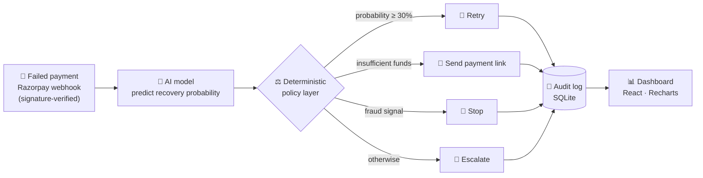
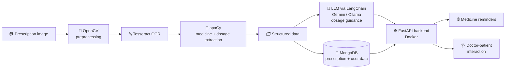

<div align="center">


**AI & Backend Developer · Agentic AI · LLM Systems**


</div>

---

## ⚡ TL;DR

```python
class RSreedhana:
    role        = "AI & Backend Developer"
    education   = "B.Tech CSE (AI & Data Science), Reva University (2024-2028), CGPA 9.2"
    experience  =  BACKEND AI(AGENTIC) DEVELOPER @ Geoace Studio
    wins        = ["Winner, INFINIX Data Challenge (CMRIT Bangalore, 2026)"]
    leadership  = ["Tech Lead, Google Developer Group", "Tech Core Member, Alverse"]
    superpower  = ["agentic AI", "LangChain + LangGraph", "RAG pipelines", "safe, explainable AI decisions"]
    looking_for = "AI / LLM / Agentic AI internship"

    def ship(self, idea):
        return self.build(idea).containerize().deploy().iterate()
```

---

## 🧰 Tech Arsenal

<div align="center">


<br/>


<br/><br/>


</div>

---

## 🚀 Featured Projects

### 💳 [payRescue](https://github.com/sree-dhana/payRescue): AI Payment Recovery System

> **Built to solve problems.** The model estimates recovery probability; deterministic rules pick the action, keeping every decision safe and explainable.



- **FastAPI** backend with **Razorpay Test Mode** checkout and **signature-verified webhooks**
- **SQLite** tracking, an **audit log**, and recovery-strategy analytics
- **React + Vite + Tailwind + Recharts** frontend dashboard

`FastAPI` `React` `Vite` `Tailwind` `Recharts` `SQLite` `Razorpay`

<br/>

### 💊 [Medicine Recognition & Advisory System](https://github.com/sree-dhana/healthcare_system)

> Turns a photo of a prescription into structured data, dosage guidance, and reminders.



- Extracts medicine names and dosage details from prescription images, turning **unstructured text into structured data**
- **FastAPI + MongoDB** backend with reminder scheduling and a doctor-patient interaction module
- Containerized with **Docker**

`FastAPI` `MongoDB` `OpenCV` `Tesseract` `spaCy` `LangChain` `Docker`

---

## 📈 Activity

<div align="center">


</div>

---

## 🐍 Contribution Snake

<div align="center">

<picture>
  <source media="(prefers-color-scheme: dark)" srcset="https://raw.githubusercontent.com/sree-dhana/sree-dhana/output/github-snake-dark.svg" />
  <source media="(prefers-color-scheme: light)" srcset="https://raw.githubusercontent.com/sree-dhana/sree-dhana/output/github-snake.svg" />
  
</picture>

</div>

---

## 🎯 Currently

| | |
|---|---|
| 🔭 **Exploring** | Agentic AI with LangGraph: planning, tool use, multi-agent coordination |
| 🛠️ **Hardening** | RAG and LLM apps for production: reliability, evaluation, deployment |
| 📚 **Learning** | NLP with Transformers / BERT, TensorFlow and scikit-learn |
| 💬 **Ask me about** | LangChain pipelines, FastAPI backends, OCR + LLM workflows, safe AI decision policies |

---

## 🤝 Let's Build Something

<div align="center">

[](https://www.linkedin.com/in/sreedhana-r-82b279282/)
[](mailto:rsreedhana05@gmail.com)
[](https://github.com/sree-dhana)

</div>
